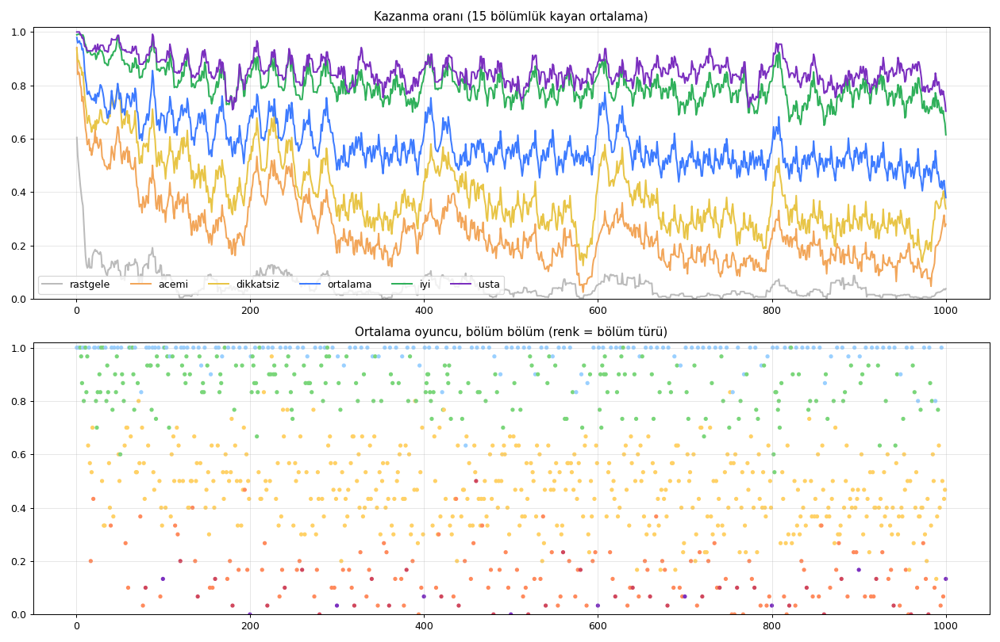

# game-level-balancer

**Simulation-driven difficulty balancing for a 1,000-level mobile puzzle game.**

I built these tools for *Grocer Match*, a triple-match puzzle game from my studio **Skymot Games**. Players tap products on shelves, and every three matching items fill a customer order. A level is lost when the 7-slot belt fills up.

The game has 1,000 levels, too many to tune by hand. So every level is **generated, solved and then played thousands of times by simulated players**. Its difficulty is set from that data, not from guesswork.



## How it works

| Step | Tool | What it does |
|---|---|---|
| 1. Generate | `tools/gen_levels.py` | Builds a candidate layout (shelves, layers, orders, mechanics) for a target difficulty tier. |
| 2. Solve | `tools/solve_level.py` | An exact search solver proves the level can be won, including mechanics such as ice, keys, chains, conveyors, bombs and timers. |
| 3. Simulate | `tools/persona_sim.py` | Six player personas play the level (160 games per level, ~160K in total). |
| 4. Filter | `tools/gen_levels.py` | Keeps the level only if every persona lands in the target band for its tier. Otherwise it tries another layout. |
| 5. Analyze | `tools/analyze_personas.py` | Measures the difficulty curve, spikes, luck levels, mechanic impact and near-miss losses, and lists the levels to regenerate. |

### Player personas

| Persona | Behavior |
|---|---|
| random | taps any valid item |
| novice | completes a pair on the belt when it sees one, otherwise random |
| careless | mostly random, sometimes spots a good move |
| average | plays greedily, keeping the belt as empty as possible |
| good | looks one move ahead, with some noise |
| expert | looks two moves ahead |

### Acceptance rules for each level

- **Not winnable by mashing:** the random player stays below a cap (hard tiers: 10% or less).
- **Fair:** the expert stays above a floor, so no level is unwinnable for a skilled player.
- **Skill matters:** the expert must beat the random player by at least 25 points. This removes "luck levels".
- **Hard means hard:** in hard tiers, the good player is capped too (hard 48%, very hard 36%, boss 40%).
- **Variety floor:** at least 4 item types from level 4 and at least 5 from level 8. With 3 types and a 7-slot belt, three of any seven items always match, so the level cannot be lost.

## Results

The first analysis pass flagged problem levels. The generator was updated and the flagged levels were regenerated.

| Issue | Before | After |
|---|---|---|
| Too easy (random tapping wins) | 55 | 37 |
| Unfair (even the expert loses) | 104 | 8 |
| Luck levels (skill makes no difference) | 41 | 8 |
| Sudden difficulty spikes | 4 | 2 |

Then the hard tiers were tightened so they demand planning:

| Tier | Average player | Good player | Expert | Random |
|---|---|---|---|---|
| hard | 24% → 15% | 62% → 37% | 71% → 53% | ~1% |
| very hard | 13% → 9% | 48% → 26% | 56% → 36% | ~0% |
| boss | 12% → 7% | 51% → 24% | 61% → 33% | ~0% |

All 1,000 levels are verified as solvable (`tools/verify_all.py`).

## Run it

Needs Python 3.10+ and `matplotlib` (only for charts). This repo includes 60 sample levels in `data/`.

```bash
python3 tools/verify_all.py                      # solve every level in data/
python3 tools/persona_sim.py liste=5,12,30       # persona win rates for chosen levels
python3 tools/persona_sim.py 1 60 out.json       # full simulation run
python3 tools/analyze_personas.py out.json docs/analysis   # curve, issues, chart
python3 tools/gen_levels.py 61 70                # generate new levels
```

The code comments are in Turkish because the project was developed in Turkish.

---
Melik Yusuf Kendal · Founder, Skymot Games
